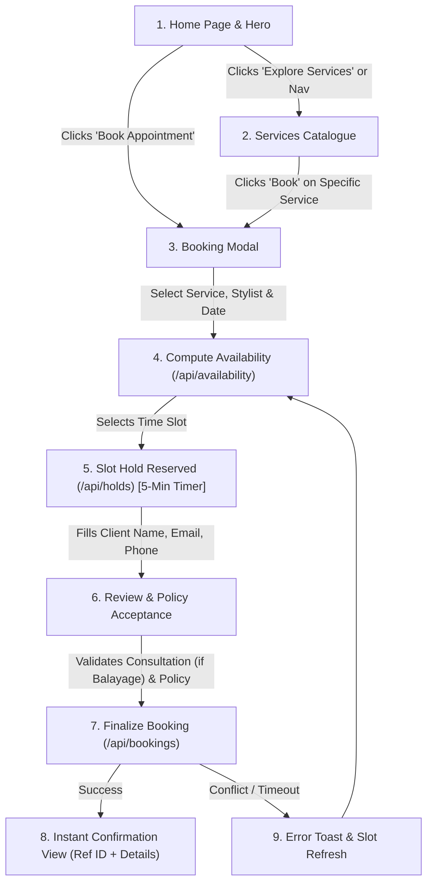

# Luma Hair Studio — Scope of Work & Product Requirements Note

**Document ID:** `LUMA-SCOPE-2026-V1`  
**Author:** Samia Qadir  
**Project:** Salon Website, Appointment Booking Engine & Social Planner  
**Status:** Approved & Implemented Starter  

---

## Task 1: One-Page Scope Document

### 1. Target Audience
* **Primary Clients:** Neighborhood clients seeking modern, low-maintenance hair styling, precision haircutting, and dimensional lived-in colour (balayage, gloss, highlights) in Brooklyn, NY.
* **First-Time Visitors:** New clients seeking clear pricing, transparent durations, stylist bios/specialties, and an effortless online booking experience without phone friction.
* **Salon Management & Stylists:** Independent studio staff needing a clean, password-protected administrative interface (`/admin`) to inspect appointments, manage live schedule states (Confirmed, Checked-in, Completed, Cancelled), and prevent double bookings.

---

### 2. Website Pages & Structural Architecture
1. **Public Single-Page Application (SPA) / Landing Portal (`/` or `index.html`):**
   * **Top Utility Bar:** Direct telephone contact (`(718) 555-0142`), studio location (`214 Bedford Ave, Brooklyn, NY`), business hours (`Mon–Sat: 10 am – 8 pm`), email, and social profiles.
   * **Header / Sticky Navigation:** Accessible wordmark branding, anchor navigation links (`#home`, `#services`, `#team`, `#studio`, `#visit`), and quick-action "Book appointment" trigger. Responsive mobile toggle menu with keyboard trap management.
   * **Hero Section:** Atmospheric visual backdrop with rich typography, rotating dynamic value proposition ("like you.", "effortless.", "radiant.", "alive."), social trust badges (Google 4.9/5 from 180+ reviews), and primary/secondary call-to-action buttons.
   * **Studio Values Ticker:** Animated infinite marquee highlighting salon standards (Thoughtful Colour, Modern Cuts, Clean & Nourishing Rituals).
   * **Editorial Introduction & Studio Philosophy:** Highlighting bespoke craft, honest consultation, and transparent pricing.
   * **Service Menu Section (`#services`):** Categorized catalog (Haircuts, Colour & Lightening, Treatments & Blowouts) displaying prices, durations, descriptions, and direct booking pre-selection buttons.
   * **Stylist & Team Roster (`#team`):** Staff profile cards featuring portraits, bios, experience tiers (Senior Colorist, Master Stylist, Texture Specialist), and direct book-with-stylist links.
   * **Atmosphere & Studio Gallery (`#studio`):** Curated 4-shot interior view showcasing styling stations, backwash sink area, botanical accents, and natural daylight.
   * **Client Testimonial Banner:** High-contrast editorial quote highlighting customer delight.
   * **Location, Hours & Visit Details (`#visit`):** Subway directions (L train to Bedford Ave), parking notes, and map integration.
   * **Footer:** Full salon contact info, copyright, accessibility statement, and discreet staff dashboard link (`/admin`).
   * **Mobile Floating Booking Bar:** Sticky bottom action bar on mobile screens ensuring 1-tap booking access.
2. **Booking Modal System (`<dialog id="booking-dialog">`):**
   * 4-step progressive disclosure flow (Service & Stylist selection → Date & Computed Availability → Client Information & Policy Acceptance → Confirmation & Summary).
3. **Staff Dashboard (`/admin` / `admin.html`):**
   * Password/token-authenticated dashboard (`SALON_ADMIN_KEY`), appointments table, status transitions, service catalog management, and filter controls.

---

### 3. Service Catalogue & Sample Content
All services feature upfront pricing, fixed service durations for slot calculations, and consultation prerequisites:

| Service Name | Category | Duration | Price | Prerequisites / Details |
| :--- | :--- | :--- | :--- | :--- |
| **Bespoke Haircut & Finish** | Haircuts | 60 mins | $120 | Precision wet/dry cut, cleansing wash, and customized blowout. |
| **Studio Blowout & Style** | Haircuts | 45 mins | $75 | Nourishing cleanse and signature round-brush blowout. |
| **Dimensional Balayage & Gloss** | Colour & Lightening | 180 mins | $310 | Hand-painted highlights, custom gloss toner, bond treatment, and blow dry. *Requires completed Colour Consultation.* |
| **Full Custom Foil Highlights** | Colour & Lightening | 150 mins | $260 | Customized foil placement for maximum lift, gloss, and finish. |
| **Single Process Root Touch-Up** | Colour & Lightening | 75 mins | $130 | Grey coverage or root refresh with ammonia-free conditioning colour. |
| **Complimentary Colour Consultation** | Consultations | 15 mins | $0 | Required preliminary 15-min consultation before balayage to assess hair history and strand health. |
| **Botanical Repair Hair Mask** | Treatments | 30 mins | $50 | Deep conditioning treatment formulated with plant squalane and ceramides. |

---

### 4. Staff Profiles
* **Elena Rostova — Creative Director & Master Colorist:** 14+ years experience; specialist in lived-in balayage, corrective colour, and blonde transitions.
* **Marcus Chen — Senior Stylist & Texture Specialist:** 9+ years experience; specialist in precision bobs, curly cutting, effortless layers, and natural movement.
* **Sophie Laurent — Senior Colorist & Styling Lead:** 8+ years experience; specialist in soft brunette tones, gloss finishes, and bridal styling.
* *System Feature:* Clients can also select **"Any Available Stylist"** to view all combined available slots across the entire roster.

---

### 5. Booking Fields Specification
| Field Name | Type | Validation / Constraints | Required? |
| :--- | :--- | :--- | :--- |
| `serviceId` | Select / Dropdown | Must match active service ID from `/api/services` | Yes |
| `stylistId` | Select / Dropdown | Specific stylist ID or empty string for "first available" | Optional (defaults to any) |
| `date` | Date picker (`YYYY-MM-DD`) | Today through +60 days; Sundays disabled (studio closed) | Yes |
| `startAt` | Slot Button Picker | ISO 8601 timestamp string computed by `/api/availability` | Yes |
| `clientName` | Text input | Minimum 2 characters, maximum 80 characters | Yes |
| `clientEmail` | Email input | Standard RFC 5322 regex validation | Yes |
| `clientPhone` | Tel input | Standard phone format (e.g. `(XXX) XXX-XXXX`) | Yes |
| `notes` | Textarea | Special styling requests, allergies, hair history (max 300 chars) | Optional |
| `consultationCompleted` | Checkbox | Mandatory `true` validation if booking Balayage | Conditional |
| `policyAccepted` | Checkbox | Mandatory acceptance of 24-hour cancellation policy | Yes |

---

### 6. Confirmation Behavior & Concurrency Architecture
* **5-Minute Temporary Slot Hold (`POST /api/holds`):**
  When a user picks an available start time, an exclusive reservation hold is created for 5 minutes (`holdId`). Competing requests for the same stylist/time slot receive an instant `409 Conflict`, preventing double-booking during checkout.
* **Serialized Booking Finalization (`POST /api/bookings`):**
  A queue serializes write operations to disk (`data/store.json`). The hold token is validated, policy acceptance timestamp is verified, and the booking is converted into a confirmed appointment.
* **Confirmation Screen:**
  * Renders a success checkmark, unique Confirmation Reference ID (e.g., `#LUM-94812`), appointment summary (Service, Stylist, Date, Time, Studio Address), and instructions on arriving 10 minutes early.
  * Form inputs are cleared and hold tokens destroyed.
  * Clear instructions displayed regarding the 24-hour cancellation window.

---

### 7. Out-of-Scope Items (Starter Phase)
* **Live Credit Card Processing / Merchant Gateways:** No Stripe/Square tokenization or payment capture (marked for Phase 2 deposit enforcement).
* **Automated External SMS / Email Gateways:** Confirmation is provided in-app; external SendGrid/Twilio integrations are labeled as future extensions.
* **Client Login / Account Creation:** Client booking is friction-free without requiring account registration.
* **Multi-Location Franchise Routing:** Designed for the Brooklyn flagship atelier.

---

### 8. User Flow Diagram



**Text/ASCII Flow Representation:**
```text
[ Home Page / Hero / Nav ]
       │
       ▼
[ Services Catalogue ]
       │
       ▼ (Selects Service e.g. Bespoke Haircut)
[ Booking Form Modal ]
       │ ──> Select Stylist (or First Available)
       │ ──> Pick Date (Mon–Sat)
       │ ──> Select Live Computed Time Slot (Triggers 5-min Hold)
       │ ──> Enter Name, Email, Phone
       │ ──> Confirm Consultation (if Balayage)
       │ ──> Accept Cancellation Policy
       ▼
[ Review Booking Details ]
       │
       ▼ (Submits POST /api/bookings)
[ Confirmation View ]
       └──> Confirmation Reference (#LUM-XXXXX)
       └──> Service, Stylist, Date & Time Summary
       └──> Arrival & 24h Cancellation Guidance
```

---

## Task 4: Social Planner Scope & Feature Specification

### 1. Module Overview
The **Luma Social Planner** is a studio marketing companion designed to curate, schedule, and stage organic social media content (hair transformations, balayage before/after reels, stylist spotlights, and studio announcements).

### 2. Core Functional Requirements
1. **Interactive Content Calendar:**
   * Monthly and weekly grid view of planned salon content.
   * Visual badge indicators for post status: `Draft` (Yellow), `Scheduled` (Blue), `Published` (Green), `Failed` (Red).
   * Filter posts by platform or assigned stylist.
2. **Post Composer Modal:**
   * Clean rich-text editor for composing captions.
   * Media asset uploader / preview for high-resolution salon photography (JPEG, PNG, MP4 up to 60s).
   * Live smartphone mock-up preview showing how the post will appear in feed.
3. **Caption & Copy Tools:**
   * Dynamic character counter with platform-specific limits (Instagram: 2,200 chars; Facebook: 63,206 chars; Pinterest: 500 chars).
   * Salon hashtag presets (`#BrooklynHair`, `#LivedInColour`, `#LumaHairStudio`, `#BedfordAveSalon`).
   * Stylist credit tagging (`@elena.hair`, `@marcus_cuts`).
4. **Platform Selector (Multi-Channel Staging):**
   * Multi-select checkboxes for targeted social channels:
     * `Instagram` (Feed & Stories)
     * `Facebook` (Studio Page)
     * `Pinterest` (Hair Inspo Boards)
     * `Google Business Profile` (What's New / Studio Updates)
5. **Scheduled Date & Time:**
   * Date and time picker configured to studio local timezone (`America/New_York`).
   * Preset "Optimal Engagement Times" tailored to salon booking spikes (e.g., Tuesdays at 7:00 PM, Sundays at 11:00 AM).
6. **Draft & Scheduling State Engine:**
   * `Draft`: Incomplete post saved for team review.
   * `Scheduled`: Approved by studio manager with a confirmed timestamp.
   * `Ready for Manual Dispatch`: Copy-to-clipboard and photo download for direct mobile posting.

### 3. Future Work & External API Boundary Notice
> [!IMPORTANT]  
> **External API Publishing Notice:**  
> Direct, automated publishing to third-party networks (Meta Graph API for Instagram/Facebook, Pinterest API, TikTok Content Posting API) is explicitly categorized as **Phase 2 Future Work**. Third-party API credentials, developer app verification, token refresh mechanisms, and platform privacy agreements must be implemented before external dispatch is enabled. The current phase provides the internal planning calendar, database persistence, and staging workflow.
