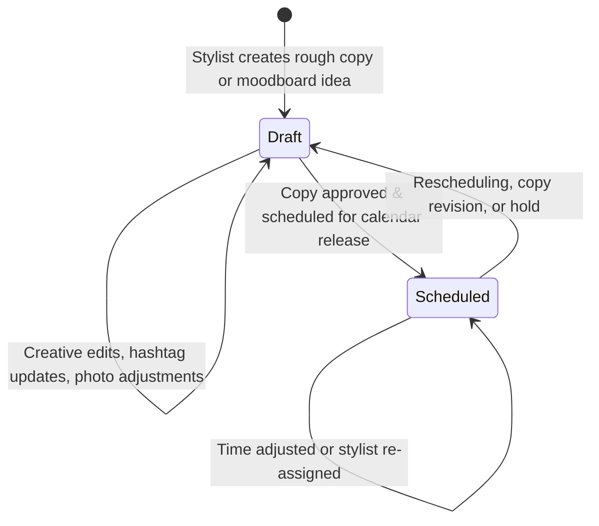

# Luma Studio — Social Planner Wireframes Specification

**Document ID:** `WF-LUMA-2026-PLANNER`  
**Version:** `1.0.0` (Wireframe Prototype)  
**Status:** Approved for Implementation & Review  
**Audience:** Creative Director, Salon Atelier Staff, Frontend Engineers, QA  
**Disclaimer:** *Internal planning wireframe only. Do not imply real platform publishing. No external social media APIs or OAuth credentials are connected or invoked.*

---

## 1. Executive Summary & Objective

The **Luma Studio Social Planner** is an internal editorial scheduling workspace designed for salon stylists and marketing managers to brainstorm, draft, and organize social content across **Instagram**, **Facebook**, **Pinterest**, and **TikTok**. 

### Core Design Principles:
1. **Editorial Planning Only:** All posts are persisted locally in `data/store.json`. The UI explicitly avoids claiming or implying real-world publishing to live social platforms.
2. **Dual-Status Lifecycle:** Posts transition transparently between **Draft** (unapproved copy/concept under review) and **Scheduled** (approved date and time reserved on the atelier marketing calendar).
3. **Synchronized Multi-View Architecture:** Seamless toggling between **Month Calendar Grid**, **Editorial Pipeline List**, and **Live Phone Wireframe Preview**.

---

## 2. Screen 1: Editorial Calendar Wireframe

The **Calendar View** provides a month-at-a-glance layout displaying scheduled content drops, visual creative thumbnails, platform tags, and status badges.

### ASCII Wireframe Layout:
```
+----------------------------------------------------------------------------------------------------+
|  [luma.] SOCIAL PLANNER WIREFRAME     [↻ Refresh Feed]  [+ New Post Wireframe]   [Exit to Home]    |
|  Monthly editorial calendar, copy draft composer, and status scheduling matrix.                     |
+----------------------------------------------------------------------------------------------------+
|  [📅 Month Calendar]  [📋 Editorial List (4)]  [📐 Wireframe Blueprints]   | Filter: [All] [Draft] [Sched]|
+----------------------------------------------------------------------------------------------------+
|                                                                                                    |
|  November 2026  [Atelier Editorial Schedule]                                [← Oct] [Current] [Dec →]|
+------------+------------+------------+------------+------------+------------+----------------------+
|    MON     |    TUE     |    WED     |    THU     |    FRI     |    SAT     |         SUN          |
+------------+------------+------------+------------+------------+------------+----------------------+
| 26         | 27         | 28         | 29         | 30         | 31         | 1                    |
|            |            |            |            |            |            |                      |
+------------+------------+------------+------------+------------+------------+----------------------+
| 2          | 3          | 4 [TODAY]  | 5          | 6          | 7          | 8                    |
|            |            | +--------+ |            | +--------+ |            |                      |
|            |            | |📸 IG   | |            | |👥 FB   | |            |                      |
|            |            | |SCHED   | |            | |SCHED   | |            |                      |
|            |            | |Honey...| |            | |Jules...| |            |                      |
|            |            | |⏰11:30 | |            | |⏰14:00 | |            |                      |
|            |            | +--------+ |            | +--------+ |            |                      |
+------------+------------+------------+------------+------------+------------+----------------------+
| 9          | 10         | 11         | 12         | 13         | 14         | 15                   |
|            | +--------+ |            | +--------+ |            |            |                      |
|            | |📌 PIN  | |            | |🎵 TT   | |            |            |                      |
|            | |DRAFT   | |            | |DRAFT   | |            |            |                      |
|            | |Mood... | |            | |Copper..| |            |            |                      |
|            | |⏰10:00 | |            | |⏰17:30 | |            |            |                      |
|            | +--------+ |            | +--------+ |            |            |                      |
+------------+------------+------------+------------+------------+------------+----------------------+
```

### Key UI Elements:
- **Mandatory Disclaimer Banner:** Prominently anchored at the top of the viewport (`#fff8e7` warm amber with `2px dashed #d4a34b` border):  
  *"⚠️ Wireframe Prototype: Internal Social Content Planner & Post Composer — For editorial schedule and caption layout only. Do not imply real platform publishing."*
- **Month Header & Navigation:** Displays selected month (e.g., `November 2026`) with Previous, Today, and Next controls.
- **Calendar Day Cells:**
  - Date number (`1` to `31`), with today's date highlighted in solid olive pill (`#434a35`).
  - Hover `+` icon button: Opens the Post Composer pre-populated with that cell's exact date.
  - Out-of-month padding days rendered with subdued opacity (`0.6`) and subtle dotted styling.
- **Post Wireframe Cards:**
  - **Platform Badge:** Color-coded platform identifier (Instagram: `#bc2a8d`, Facebook: `#1877f2`, Pinterest: `#e60023`, TikTok: `#000000`).
  - **Status Pill:** Distinct visual styling:
    - `Draft`: Subdued stone gray (`#e9e8e2`, text `#4f4e46`)
    - `Scheduled`: Olive tint (`#e7e9df`, text `#434a35`)
  - **Caption Excerpt:** Truncated to 2 lines with ellipsis (`-webkit-line-clamp: 2`).
  - **Planned Time Indicator:** `⏰ 11:30 AM` indicating the scheduled release slot.

---

## 3. Screen 2: Post Composer Modal Wireframe

The **Post Composer** provides a side-by-side editing interface where creators formulate copy, pick mock platforms, set publish timings, and preview how the layout appears in a real smartphone feed.

### ASCII Wireframe Layout:
```
+----------------------------------------------------------------------------------------------------+
| CONTENT STUDIO WIREFRAME                                                                           |
| Edit Social Post Wireframe                                                                    [×]  |
+------------------------------------------------------------+---------------------------------------+
| 01 · TARGET PLATFORM *                                     | LIVE FEED PREVIEW                     |
| [📸 Instagram (@lumahairnyc)]  [👥 Facebook (Luma Studio)] | +-----------------------------------+ |
| [📌 Pinterest (Moodboards)]    [🎵 TikTok (@luma.cuts)]    | | [Luma Hair Studio - Brooklyn, NY] | |
|                                                            | |                                   | |
| 02 · CAPTION COPY *                       216 / 2,200 Char | |       [ PHOTO ASSET ]             | |
| +--------------------------------------------------------+ | |    Aspect Ratio 4:5 / 1:1         | |
| | Soft lived-in waves and warm honey tones by @maya. The | | |   (Honey Blonde Balayage)         | |
| | secret to effortless dimensional colour is low-        | | |                                   | |
| | maintenance placement that grows out seamlessly...     | | +-----------------------------------+ |
| +--------------------------------------------------------+ | | ♡ 💬 ↗                           | |
| Quick Tags: [#LumaStudio] [#BrooklynHair] [#Balayage]      | | lumastudio.brooklyn Soft lived-in | |
|                                                            | | waves and warm honey tones by...  | |
| 03 · PLANNED DATE & TIME *       Peak engagement: 11:30 AM | +-----------------------------------+ |
| Planned Date: [ 2026-11-04 ]    Planned Time: [ 11:30 AM ] |                                       |
|                                                            |                                       |
| 04 · PHOTO / CREATIVE ASSET              Aspect 4:5 / 1:1  |                                       |
| [ Honey Blonde Balayage & Waves (Maya Chen)          v ]   |                                       |
|                                                            |                                       |
| 05 · EDITORIAL STATUS *                                    |                                       |
| ( ) Draft — Save internally for copywriting & team review  |                                       |
| (*) Scheduled — Approved date & time on studio calendar    |                                       |
+------------------------------------------------------------+---------------------------------------+
| ⚠️ Planning Wireframe only · Stored in data/store.json      | [Cancel]  [Save Draft] [Schedule Post]|
+------------------------------------------------------------+---------------------------------------+
```

### Component Field Matrix:

| Field Name | Type | Options / Constraints | Validation Rule | Wireframe Purpose |
| :--- | :--- | :--- | :--- | :--- |
| **Platform** | Single/Multi Select Pills | Instagram, Facebook, Pinterest, TikTok | Required (at least 1 platform selected) | Targets mock social channel |
| **Caption** | Textarea | Max 2,200 characters | Required (non-empty string) | Post caption & hashtag drafting |
| **Planned Date** | Date Input | `YYYY-MM-DD` | Required (valid ISO date) | Calendar placement anchor |
| **Planned Time** | Time Input | `HH:MM` (24hr or AM/PM) | Required (defaults to 11:30) | Optimal engagement slot |
| **Asset Mock** | Select Dropdown | 4 Pre-curated salon photoshoot assets | Optional (defaults to asset 1) | Feeds live phone mockup preview |
| **Status** | Radio Group | `Draft` vs `Scheduled` | Required (`Draft` or `Scheduled`) | Content lifecycle state |

### Primary Actions:
- **Save as Draft:** Persists the record to `data/store.json` with `status: "Draft"`. The card renders in gray on the calendar.
- **Schedule Post:** Persists the record with `status: "Scheduled"`. The card renders with olive highlight and scheduled time.
- **Cancel:** Dismisses the dialog without mutations.

---

## 4. Status Lifecycle & Transition Matrix



1. **`Draft` Status:** Indicates the concept is in progress. Stylists can experiment with copy variations and test hashtags without cluttering confirmed calendar releases.
2. **`Scheduled` Status:** Represents content that has been vetted by the atelier lead and allocated to a specific day and time on the internal editorial calendar.
3. **No External Side Effects:** Transitioning to `Scheduled` does NOT call any external webhooks, OAuth APIs, or publishing pipelines.

---

## 5. Visual Wireframe Evidence

- **Calendar Wireframe Screenshot:** [`screenshots/social_planner_calendar.png`](file:///c:/Users/samiaqadir/Desktop/SMJPROJECTS/SALON%20WEBSITE/screenshots/social_planner_calendar.png)
- **Composer Wireframe Screenshot:** [`screenshots/social_planner_composer.png`](file:///c:/Users/samiaqadir/Desktop/SMJPROJECTS/SALON%20WEBSITE/screenshots/social_planner_composer.png)
- **Live Interactive Endpoint:** [`public/planner.html`](file:///c:/Users/samiaqadir/Desktop/SMJPROJECTS/SALON%20WEBSITE/public/planner.html)
- **Embedded Admin Tab:** Accessible via Staff Dashboard at `/admin` (`#tab-planner`).
